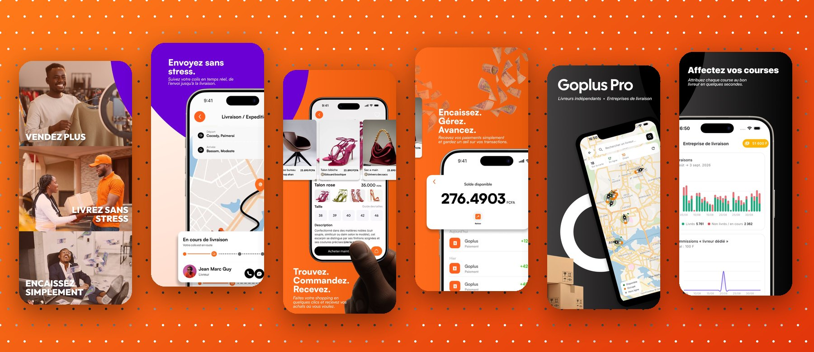
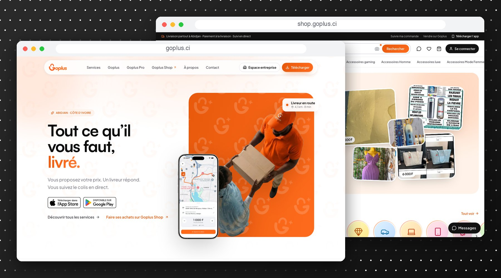
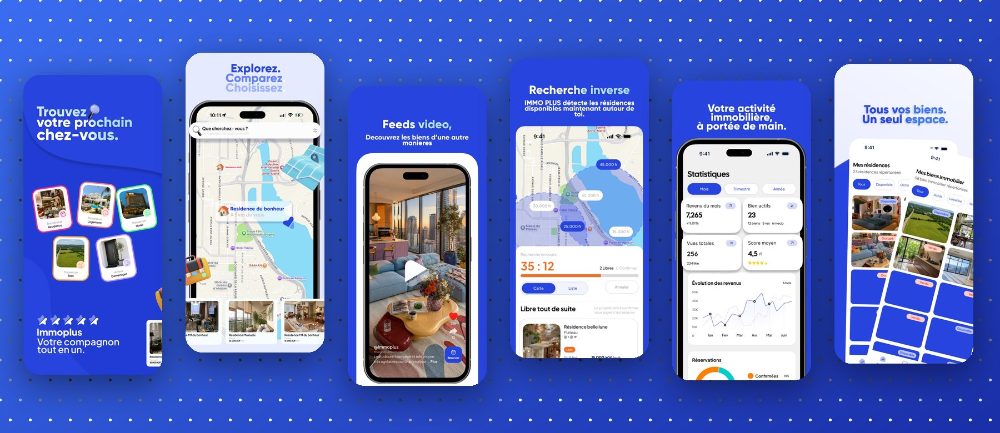
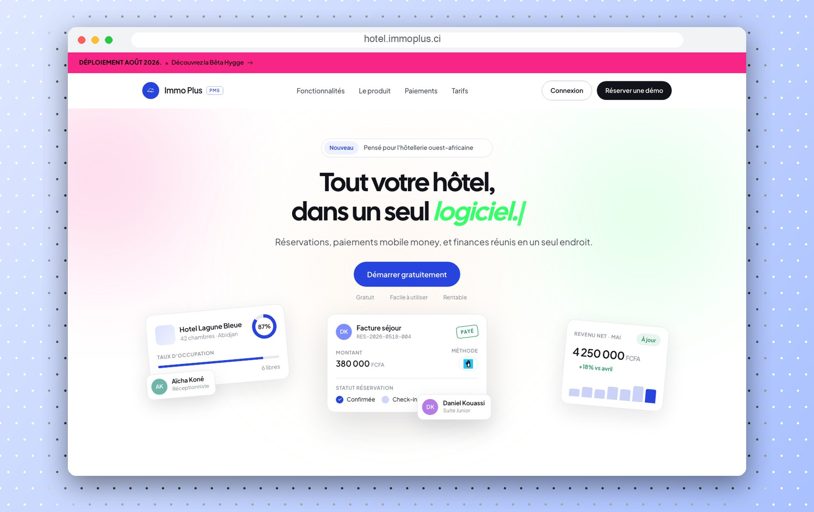
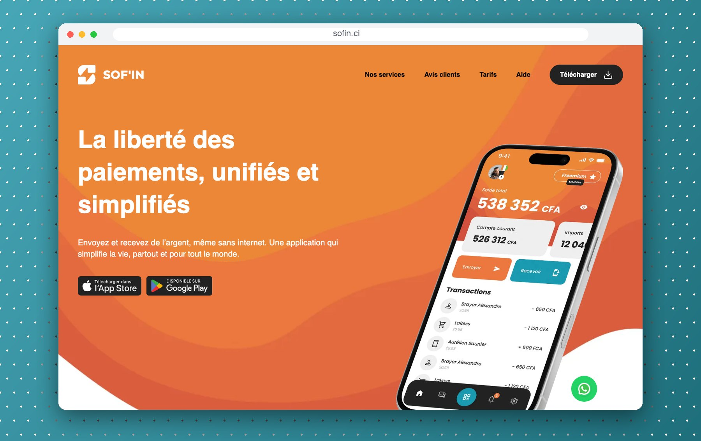
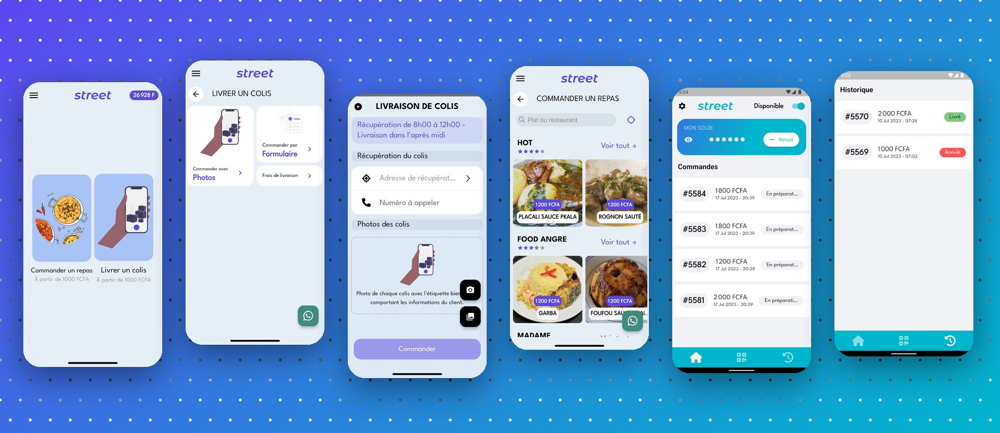

  

  
  
  
  
  

## 👋 À propos

Ingénieur **full-stack, mobile et DevOps**, basé à **Abidjan 🇨🇮**. Je cofonde et je dirige la technique de startups qui résolvent de vrais problèmes du quotidien en Afrique de l'Ouest : **livraison, e-commerce, immobilier, hôtellerie et paiement mobile**.

Je m'occupe de toute la chaîne : conception produit et UX, apps **iOS / Android**, plateformes **web**, **APIs**, **infrastructure**, mise en production et maintenance. Mes produits tournent **en production** et sont utilisés chaque jour par **des milliers de personnes**.

<table>
  <tr>
    <td align="center" width="25%"><h3>7</h3>apps mobiles en production (App Store & Google Play)</td>
    <td align="center" width="25%"><h3>20 000+</h3>téléchargements sur Google Play</td>
    <td align="center" width="25%"><h3>4</h3>produits lancés de A à Z</td>
    <td align="center" width="25%"><h3>💸</h3>Orange Money · MTN Wave · paiement à la livraison</td>
  </tr>
</table>

### 🧰 Ce que j'apporte

<table>
  <tr>
    <td valign="top" width="33%">
      <b>📱 Mobile</b>  
      Apps <b>Flutter</b> et natives (<b>Kotlin</b>, iOS), suivi GPS en temps réel, cartes, notifications push, mode hors ligne, publication et suivi sur les stores.
    </td>
    <td valign="top" width="33%">
      <b>🌐 Full-Stack Web</b>  
      <b>Next.js / React</b>, <b>Nuxt / Vue</b>, APIs <b>Node.js</b> & <b>Laravel</b>, marketplaces, back-offices, tableaux de bord, SEO et performance.
    </td>
    <td valign="top" width="33%">
      <b>⚙️ DevOps & Lead Tech</b>  
      Architecture, <b>Docker</b>, <b>CI/CD</b>, Linux & Nginx, supervision, intégration des paiements mobile money, gestion d'équipe et roadmap produit.
    </td>
  </tr>
</table>

---

## 🚀 Produits en production

 

###  &nbsp;Goplus · Livraison, marketplace et encaissement

> **Cofondateur & CTO** · [goplus.ci](https://goplus.ci/) · [shop.goplus.ci](https://shop.goplus.ci/)

Goplus met en relation **ceux qui vendent, ceux qui achètent, ceux qui livrent et ceux qui ont besoin de faire livrer**. Une commande passée sur la marketplace devient une course pour un livreur, et le stock du vendeur se met à jour tout seul. Le produit cible les vendeurs en ligne ivoiriens (WhatsApp, Instagram, TikTok, Facebook).

  

**Ce que j'ai construit**

- 🛰️ **Recherche de livreurs par vagues** : la recherche démarre près du point de retrait puis élargit son rayon jusqu'à trouver quelqu'un. Chaque invitation a un délai, chaque offre une durée de validité, et une course ne peut pas être attribuée deux fois.
- 🤝 **Prix négocié en temps réel** : le client propose un montant, les livreurs acceptent ou font une contre-offre et les réponses arrivent en direct. Un prix plancher et une estimation suggérée encadrent la négociation.
- 📍 **Suivi en direct** : position du livreur, itinéraire et distance restante. Le destinataire peut suivre le colis via un simple lien.
- 🔐 **Preuve de livraison à deux codes** (code à 5 chiffres ou QR à la récupération, puis code à la remise). La remise confirmée **déclenche automatiquement le règlement** : le vendeur est crédité, le livreur payé et la commission prélevée.
- 💰 **Portefeuille et mobile money** : retraits vers Orange Money, MTN Money ou Wave, et paiement en espèces à la livraison.
- 🛍️ **Marketplace multi-boutiques** : panier multi-vendeurs livré en une seule course, messagerie acheteur ↔ vendeur, vidéos produits, promotions et gestion de stock intégrée.
- 📦 **Plusieurs types de course** : livraison standard, multi-livraisons, expédition hors de la ville, précommande, commande multi-vendeurs et livreur dédié.

<table>
  <tr>
    <td width="64" align="center"></td>
    <td><b>Goplus</b> Vendeurs, boutiques et clients</td>
    <td align="center">⭐ 4,4 · 1 k+ téléchargements</td>
    <td align="right">
      
      
    </td>
  </tr>
  <tr>
    <td width="64" align="center"></td>
    <td><b>Goplus Pro</b> Livreurs indépendants et entreprises de livraison</td>
    <td align="center">Flotte, tournées, portefeuille</td>
    <td align="right">
      
      
    </td>
  </tr>
</table>

  

 

###  &nbsp;Immo Plus · Immobilier, location courte durée et hôtellerie

> **Cofondateur & CTO** · [immoplus.ci](https://immoplus.ci/) · [hotel.immoplus.ci](https://hotel.immoplus.ci/) · [LinkedIn](https://www.linkedin.com/company/immo-plus-app/)

Une plateforme pour **trouver, louer, acheter et gérer** des biens en Côte d'Ivoire, avec des annonces vérifiées, une app pour les particuliers et une app pour les professionnels. Elle compte **plus de 10 000 utilisateurs actifs**.

  

**Ce que j'ai construit**

- 🗺️ **Recherche sur carte et recherche inverse** : l'app détecte les résidences **disponibles maintenant** autour de l'utilisateur, avec un compte à rebours pendant la réservation.
- 🎬 **Feed vidéo**, comme sur les réseaux sociaux, pour découvrir les biens.
- 🎯 **Imatch** : l'app rapproche automatiquement la demande d'un client (zone, type de logement, budget) des biens publiés par les professionnels.
- 💬 **Messagerie en temps réel** entre clients et propriétaires, réservations et organisation des visites.
- 📊 **Espace pro** : publication des biens, statistiques (revenus, vues, note moyenne), portefeuille et retraits.
- 🏨 **Immo Plus PMS** : logiciel de gestion hôtelière avec plan des chambres en direct, taux d'occupation, RevPAR, arrivées et départs, facturation et **paiements mobile money** (Wave, Orange Money, MTN).

<table>
  <tr>
    <td width="64" align="center"></td>
    <td><b>Immo Plus</b> Recherche, location et achat de biens</td>
    <td align="center">10 k+ téléchargements</td>
    <td align="right">
      
      
    </td>
  </tr>
  <tr>
    <td width="64" align="center"></td>
    <td><b>Immo Plus Pro</b> Agences, propriétaires et gestionnaires</td>
    <td align="center">1 k+ téléchargements</td>
    <td align="right">
      
      
    </td>
  </tr>
</table>

  

 

###  &nbsp;Sof'In · Paiements unifiés, même sans internet

> **Lead Developer** · [sofin.ci](https://sofin.ci/)

Une application de paiement qui fonctionne **avec tous les opérateurs mobile money et en espèces**, et qui reste utilisable **hors connexion** dans les zones mal couvertes.

  

- 📶 **Paiements hors connexion** (carte hors ligne et code secret) : on peut payer et envoyer de l'argent sans réseau.
- 🔁 **Transferts gratuits** entre utilisateurs Sof'In, et interopérabilité avec tous les opérateurs.
- 🧾 **Partage de l'addition** en un clic pour les paiements de groupe.
- 💎 **Offre VIP** : épargne progressive, paiement en plusieurs fois et carte virtuelle sécurisée pour les achats en ligne.

 

###  &nbsp;Street · Logistique et paiement pour le commerce en ligne

> **Lead Developer** · [street.ci](https://street.ci/)

Des briques numériques pour le **commerce informel en Afrique** : logistique, paiement et marketplace. Un vendeur enregistre ses colis, les fait livrer et retire son argent instantanément.

  

- 📸 **Enregistrement des colis** par formulaire ou **par photo** de l'étiquette.
- 📍 **Suivi en temps réel**, **Street Wallet** et retrait instantané vers le mobile money de son choix.
- 🍲 **Livraison de repas** (dabali) avec des frais de livraison dès 200 F.
- 🏍️ **Street Moto**, l'app des livreurs : disponibilité, courses sur la carte, historique et solde.

<table>
  <tr>
    <td width="64" align="center"></td>
    <td><b>Street CI</b> Vendeurs en ligne et clients</td>
    <td align="center">⭐ 4,2 · 170 avis · 10 k+ téléchargements</td>
    <td align="right">
      
      
    </td>
  </tr>
  <tr>
    <td width="64" align="center"></td>
    <td><b>Street Moto</b> Livreurs à moto</td>
    <td align="center">⭐ 4,8 · 500+ téléchargements</td>
    <td align="right">
      
    </td>
  </tr>
</table>

---

## 🛠️ Stack technique

  
   
  

<b>🗂️ Projets antérieurs</b>

 

**Uskip**

  
  
  

**Immo Plus, première version (2023)**

  
  
  

**Saloon**

  
  

**Event App**, gestion d'événements en C et Python

---

  <b>Vous avez un produit à lancer ou une équipe tech à structurer ? Parlons-en.</b>  
  
  
  

